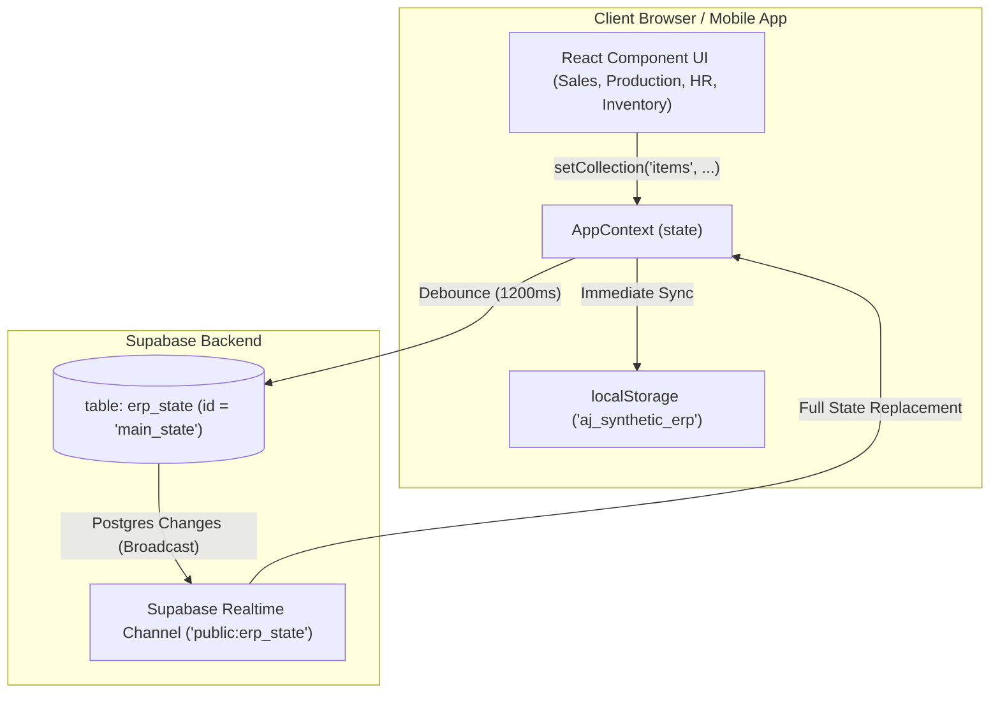

# FlashVision ERP (sale_orders_app) — Codebase Audit & Architectural Tour Report

> **Prepared for:** Omer (Owner & Principal)  
> **Repository:** `sale_orders_app` (Vite + React 19 Enterprise Web & Mobile ERP)  
> **Audit Date:** October 2026  
> **Status:** Complete System Analysis & Architectural Blueprint  
> **Output Target:** `/home/hatch/workspace/erp/ERP_ANALYSIS_REPORT.md`

---

## 1. Executive Summary

FlashVision ERP (`sale_orders_app`) is a feature-rich, multi-platform Enterprise Resource Planning (ERP) platform developed with **React 19, Vite, Tailwind CSS, Supabase, Capacitor (Android), and Electron (Desktop)**. The system is designed to run factory floor operations, supply chain logistics, manufacturing, financial accounting, team chat, and attendance terminals across three target platforms:
1. **Web Portal** (hosted on Firebase Hosting at `flashvision-erp.web.app`)
2. **Mobile Attendance Terminal & Chat** (`Flash AM` and `FlashVision Chat` native Android APKs built via Capacitor and GitHub Actions CI)
3. **Desktop Windows Client** (packaged via Electron and NSIS installer)

The application spans over **85,000 lines of custom React/JavaScript code** organized across 18 high-level page views and 60+ modular sub-screens. It features full-fledged modules for Sales Orders, Order Management (OMS), Production Planning (BOM, Batch Closing, Raw Material processing), Inventory (Stock, Rate Profiles, Reorder Levels, Gate Passes, GRN), Delivery Challans, Double-Entry Finance (General Ledger, Invoicing, Vouchers, Tax, Cost Centers, Chart of Accounts), Human Resources (Employee Directory, Onboarding, Machine Attendance, Loans, Salary Generation), WhatsApp-grade Team Chat with WebRTC calling, and an AI Copilot engine with Gemini multi-key failover and speech synthesis.

### High-Level Verdict:
While the feature breadth and domain alignment (specifically for textile and synthetic leather manufacturing) are extraordinarily comprehensive, the application currently suffers from **critical architectural, security, and performance bottlenecks**:
- **Critical Data Pipeline Fragility:** The entire core ERP state (orders, items, customers, production, inventory, financial vouchers, employee records) is serialized and stored as a **single monolithic JSON blob** in the Supabase PostgreSQL table `erp_state` (`id = 'main_state'`). Every user edit triggers a full document replacement after a 1.2-second debounce. Under concurrent multi-user operations (e.g. sales rep creating an order while a factory worker punches attendance), **last-write-wins race conditions will silently overwrite and erase business data**.
- **Critical Security Exposure:** The Supabase public Row Level Security (RLS) policies on `erp_state` allow **unauthenticated public read, insert, and update**. Password verification and role authorization occur client-side using a static salt hardcoded in frontend source code. In addition, 10 Google Gemini API keys are base64-encoded and baked directly into client bundle files, and legacy Firebase RTDB / Firestore rules remain completely open (`read: true, write: true`).
- **Performance & Monolithic Component Bloat:** Key components (`ChatModule.jsx` at 7,024 lines, `AppContext.jsx` at 5,149 lines, `HRAttendance.jsx` at 3,331 lines, `FlashAM.jsx` at 2,648 lines) contain massive internal state, lack table virtualization for large record sets, and execute frequent heavy JSON stringification cycles on every render.

This report documents every page, data pipeline, native bridge, build pipeline, weak point, and prioritized remediation roadmap to serve as the master technical foundation for all subsequent stability and security engineering.

---

## 2. Project Structure Map

```
sale_orders_app/
├── android/                         # Capacitor Native Android Container for Flash AM Terminal
│   ├── app/src/main/
│   │   ├── AndroidManifest.xml      # Camera, Mic, Biometrics, Storage permissions
│   │   ├── java/com/flashvision/app/
│   │   │   └── MainActivity.java    # BridgeActivity with Print, Biometric, & FileSaver bridges
│   │   └── res/                     # Native themes, drawables, app icons, splash screens
│   └── build.gradle                 # Gradle 8 Android build configuration
├── chat-mobile/                     # Standalone Capacitor sub-project for "FlashVision Chat"
│   ├── android/                     # Android build wrapper (com.flashvision.chat)
│   ├── capacitor.config.json        # Chat-specific Capacitor configuration
│   └── package.json                 # Capacitor Android dependencies
├── public/                          # Static assets, fonts, icons, hero banners
├── src/
│   ├── assets/                      # SVGs and UI media
│   ├── components/
│   │   ├── dashboard/               # Grid widgets (Target, Items, Working Days, Smart Shelf)
│   │   ├── delivery/                # DelCreation, DelCreationSlip, DelDashboard, DelRecord
│   │   ├── finance/                 # GL, Statements, AR/AP, Invoices, Vouchers, Tax, COA
│   │   ├── hr/                      # Directory, Attendance, Onboarding, Loans, Salary, Settings
│   │   ├── inventory/               # Stock, GRN, GatePass, Adjustments, Rate Profile, Transfer
│   │   ├── oms/                     # OmsFilter, OmsSelection, OmsAdjustment, OmsHistory, OmsSlip
│   │   ├── production/              # MBR, BOM Master/Calc, Batch Closing, Stock Demands, Raw Material
│   │   ├── settings/                # Items, Customers, Suppliers, Print, Routing, Departments
│   │   ├── ui/                      # AICopilot, Combinations, Pagination, PrintStudio, Skeletons
│   │   ├── usercontrol/             # UserControl, AddNewUser, AuditLog, GranularPermissionsModal
│   │   ├── CallingOverlay.jsx       # Global WebRTC audio/video calling overlay
│   │   ├── GlobalNavGuard.jsx       # Route blocker preventing loss of unsaved changes
│   │   └── Layout.jsx               # Universal desktop & simulated mobile layout container
│   ├── constants/
│   │   └── permissionsConfig.js     # Full RBAC module, screen, and granular CRUD permissions schema
│   ├── context/
│   │   ├── AppContext.jsx           # Monolithic Global State (5,149 lines) & Supabase sync engine
│   │   └── DialogContext.jsx        # Custom Alert, Confirm, Prompt, Pill, and Loading modal engine
│   ├── hooks/
│   │   └── useDynamicColumns.js     # Table column resizing, ordering, visibility & cache hook
│   ├── pages/                       # 18 Primary Route Controllers
│   │   ├── AdminSetup.jsx           # [DEAD CODE] Unrouted standalone admin setup page
│   │   ├── ChatModule.jsx           # WhatsApp-grade Chat & Calling Studio (7,024 lines)
│   │   ├── Dashboard.jsx            # Drag-and-drop widget workspace (React Grid Layout)
│   │   ├── DeliveryDashboard.jsx    # Dispatch & Challan Management
│   │   ├── DocumentWarehouse.jsx    # 3D/2D Digital Archive Filing Cabinet & Binder DMS
│   │   ├── FinanceModule.jsx        # 12-Screen Accounting, Ledger, and Invoicing Suite
│   │   ├── FlashAM.jsx              # Standalone Mobile Attendance Kiosk Terminal (2,648 lines)
│   │   ├── HRModule.jsx             # 11-Screen HR, Payroll, Leave, and Attendance Hub
│   │   ├── InventoryDashboard.jsx   # 13-Screen Stock & Materials Logistics Dashboard
│   │   ├── Login.jsx                # Multi-theme login with brute-force lockout & custom media
│   │   ├── ProductionModule.jsx     # 14-Screen Manufacturing Execution & Batch Control
│   │   ├── ProductionOMS.jsx        # Order Management & Production Planning Flow
│   │   ├── SaleOrderModule.jsx      # Sales Orders Creation, History, and Print Studio
│   │   ├── SaleOrderReturn.jsx      # Customer Sales Return & RMA Processing
│   │   ├── SettingsDashboard.jsx    # System Configuration, Master Data, and Display Settings
│   │   ├── ThemeSettings.jsx        # Palette customizer, live contrast & dark mode switcher
│   │   ├── UserControlDashboard.jsx # RBAC, User Profiles, and System Audit Logs
│   │   └── UserProfile.jsx          # User settings, password changes, and device session manager
│   ├── services/
│   │   ├── aiAudioService.js        # Web Audio API voice synthesizers & sound effects
│   │   ├── aiConfig.js              # 10-key Gemini API failover pool & cooldown manager
│   │   ├── aiService.js             # AI Copilot brain & function-calling tools engine
│   │   └── erpBlueprint.js          # ERP system prompt and tool signatures for Gemini
│   ├── utils/
│   │   ├── contrastDetector.js      # Dynamic DOM contrast & luminance detector (WCAG 2.1 AA)
│   │   ├── fgCombinationUtils.js    # Finished Goods roll-size & packing format parsers
│   │   ├── financeEngine.js         # Double-entry transaction engine, trial balance & financial ratios
│   │   ├── printExportUtils.js      # PDF, High-Res Image, and CSV document exporter
│   │   ├── printSchemaRegistry.js   # Universal print document schemas and column templates
│   │   ├── securityAuth.js          # HMAC-SHA256 session signatures & salted password hasher
│   │   ├── supabaseClient.js        # Supabase JS client configuration
│   │   └── theme.js                 # CSS variable theme injector & mode toggle
│   ├── App.css / index.css          # Tailwind CSS directives & global scrollbar styling
│   ├── App.jsx                      # React Router v7 routes & session protection wrapper
│   └── main.jsx                     # Root React 19 mount point & RootErrorBoundary
├── .github/workflows/
│   └── build-apk.yml                # Automated CI pipeline building FlashAM.apk
├── capacitor.config.json            # Flash AM Capacitor config (AppId: com.flashvision.app)
├── electron-main.cjs                # Electron Desktop runner with local HTTP server
├── firebase.json / .firebaserc      # Firebase Web Hosting and legacy rule bindings
├── database.rules.json              # [VULNERABILITY] Public read/write Realtime Database rules
├── firestore.rules                  # [VULNERABILITY] Public read/write Firestore rules
├── supabase_setup.sql               # Base SQL table & open RLS schema
├── supabase_setup_new_project.sql   # Extended SQL schema with sessions & routing tables
├── package.json                     # NPM dependencies and build scripts
└── vite.config.js                   # Vite 8 rollup chunk splitting configuration
```

---

## 3. Module-by-Module Tour (Every Screen)

### 3.1. Authentication & Session Security (`src/pages/Login.jsx`, `src/pages/UserProfile.jsx`)
- **Login Screen (`/login`):**
  - **Purpose:** Entry portal for all web and desktop users.
  - **Features:** 
    - Username or Email authentication with client-side credential verification.
    - Anti-Brute-Force Rate Limiting (enforces a 5-minute lockout with live countdown after 5 failed attempts).
    - CapsLock detection alert.
    - "Remember Me" toggle (extends session duration from 4 hours to 24 hours).
    - Draggable UI panels (card positions can be moved freely and stored in `localStorage`).
    - Custom background media uploader (images/videos stored locally in IndexedDB `AjSyntheticSettings`).
    - Light/Dark theme switch directly from login.
- **User Profile & Device Manager (`/profile`):**
  - **Purpose:** Personal profile settings, mandatory password updates, and session governance.
  - **Features:**
    - Updates name, email, phone, and avatar.
    - Password Change Form (supports mandatory forced password change if `requirePasswordChange: true`).
    - Active Devices & Concurrent Session Manager: Queries Supabase `user_sessions` table, parses User-Agent strings into friendly device names (e.g. "Windows PC", "Android Device", "Apple Safari"), and allows the user to remotely terminate other active sessions via real-time WebSocket signals.

### 3.2. Main ERP Dashboard (`src/pages/Dashboard.jsx`)
- **Route:** `/dashboard`
- **Sub-Screens:**
  - **Overview Dashboard:**
    - Fully customizable drag-and-drop grid built on `react-grid-layout`.
    - Integrated with `WidgetRegistry.jsx` supporting 9 dynamic widgets:
      1. `ProductionTargetWidget`: Daily production target meter vs. achieved meter gauge with historical modal.
      2. `ProductionItemsWidget`: Summary of top produced finished goods and roll counts.
      3. `WorkingDaysWidget`: Current month working days counter and holiday calendar.
      4. `DeliveryWidget`: Active dispatch count, in-transit items, and delivered orders today.
      5. `ShortcutsWidget`: Quick navigation buttons to primary ERP workflows.
      6. `TodoListWidget`: Personal user task checklist with persistence.
      7. `CalendarWidget`: Mini interactive calendar with shift notes.
      8. `AppIconWidget`: Quick application launch pads.
      9. `SmartArchiveShelf`: Mini shelf previewing active document warehouse binders.
  - **E-Files Tab:** Direct link and embedded view of the Document Warehouse.

### 3.3. Sales Orders Module (`src/pages/SaleOrderModule.jsx`, `src/pages/SaleOrderReturn.jsx`)
- **Route:** `/sale-orders` and `/sale-order-return`
- **Sub-Screens:**
  - **Order Dashboard (`?tab=dashboard`):** Real-time KPI summary (Total Orders, Pending Orders, In Process, Ready/Dispatched, Total Revenue), order status distribution bars, and recent order activity feed.
  - **Create Sale Order (`?tab=create`):**
    - Customer selection dropdown with on-the-fly customer account creation.
    - Item specification builder with `FGCombinationBuilder.jsx`: allows dynamic configuration of Finished Goods (Color, Emboss, Backing, Thickness, Foam, Roll Size, Meters, Rate).
    - Commercial calculations: Gross amount, discount percentage/fixed, sales tax percentage, net payable.
    - Order attachments, target delivery date, and shipping address.
  - **Order History (`?tab=history`):**
    - Complete historical table of all sales orders with multi-column filtering (Date range, customer, order ID, status).
    - Interactive status badges (`StatusBadgeWithAction`) allowing one-click cancellation of individual line items or entire orders.
    - Print, PDF Export, Image Export, and CSV Export powered by `UniversalPrintStudioModal.jsx` and `printExportUtils.js`.
  - **Sales Returns (`/sale-order-return`):**
    - Return Merchandise Authorization (RMA) logging.
    - Records returned goods against original Sale Order IDs, specifies defect reasons (transit damage, color variation, excess), and handles warehouse stock return adjustments.

### 3.4. Order Management System (OMS) (`src/pages/ProductionOMS.jsx`)
- **Route:** `/production-flow`
- **Sub-Screens:**
  - **Filter Sale Orders (`?tab=filter`):**
    - Consolidates all pending line items across sales orders and custom stock demands (`FOR STOCK`).
    - Calculates fabric requirements and cross-checks warehouse stock levels, flagging items with `hasShortage: true` in red.
  - **Production Planning (`?tab=planning`):**
    - Selection interface (`OmsSelection.jsx`) where shop-floor planners pick unassigned items to group into a scheduled production run.
    - Adjustment interface (`OmsAdjustment.jsx`) for fine-tuning target quantities, allocating raw materials, and generating a formal planning run (`PLN-XXX`).
  - **Planning History (`?tab=history`):**
    - Historical log of all active and completed planning runs (`OmsHistory.jsx`).
    - Supports editing existing plans, re-allocating items, and printing the Production Job Slip (`OmsSlip.jsx`).

### 3.5. Production Module (`src/pages/ProductionModule.jsx`)
- **Route:** `/production`
- **Sub-Screens (14 Dedicated Views):**
  1. **Master Batch Record (MBR):** End-to-end manufacturing ticket logging raw material consumption, machinery allocation, operator shifts, and QA signatures.
  2. **Production Orders:** Active manufacturing work orders with real-time stage progress indicators.
  3. **BOM Master:** Bill of Materials recipe management. Links finished goods to required fabrics, chemicals, and stabilizers. Supports bulk CSV upload (`BulkUploadModal.jsx`).
  4. **BOM Calculator:** Interactive simulation tool that computes exact raw material requirements for any entered Finished Good meter target.
  5. **Batch Closing:** Formal closing of manufacturing runs. Records final outputs across categories (Finished Good Meters, Wastage in Kgs, B-Grade recovery), reconciling variances against planned quantities.
  6. **Item Library:** Catalog of production items with fabric ratios, roll lengths, and default recipe mappings.
  7. **Stock Demand & History:** Shop floor requisition slips requesting materials from the inventory warehouse (`StockDemand.jsx` & `StockDemandHistory.jsx`).
  8. **Stock Receiving Note & History:** Production floor confirmation of materials physically received from the warehouse (`StockReceivingNote.jsx` & `StockReceivingHistory.jsx`).
  9. **Consumption History:** Chronological log of all materials consumed across past batches.
  10. **Other Consumption:** Tracking non-BOM consumables (lubricants, packaging materials, boiler fuel, cleaning agents).
  11. **Inventory Ledger:** Sub-ledger showing production-floor raw material movements.
  12. **Inventory Adjustment:** Floor-level stock reconciliation for production losses or recovery.
  13. **Raw Material Config:** Configuration of multi-stage raw material processing routes.
  14. **Raw Material Production:** Tracking intermediate production phases (e.g. coating, laminating, embossing).

### 3.6. Inventory & Warehouse Logistics (`src/pages/InventoryDashboard.jsx`)
- **Route:** `/inventory`
- **Sub-Screens (13 Dedicated Views):**
  1. **Inventory Dashboard:** Total valuation, stock health metrics, low-stock warnings, and department distribution charts.
  2. **Inventory Stock:** Live stock levels for all Raw Materials, Finished Goods, and Consumables with multi-department filtering.
  3. **Item Rate Profile:** Manages procurement rates, selling rates, and standard valuation costs per SKU.
  4. **Reorder Levels:** Configures minimum safety stock and reorder thresholds with visual alert indicators.
  5. **Cloth Quality Setup:** Fabric conversion rules, shrinkage rates, GSM weights, and meter-to-kilogram conversion formulas.
  6. **Inventory Adjustment & History:** Manual stock adjustments (Additions/Deductions) with sequential `ADJ-XXX` numbering and audit remarks.
  7. **Inventory Ledger:** Complete chronological stock movement card (In, Out, Balance) per item with document cross-referencing.
  8. **Inventory Return:** Vendor return manifests for defective or rejected raw materials.
  9. **Purchase Demand:** Internal material purchase requisitions created by warehouse inventory officers.
  10. **Purchase Order (PO):** Formal procurement purchase orders sent to suppliers.
  11. **Inward Gate Pass (IGP):** Security checkpoint logging supplier delivery vehicles, driver details, and physical challans.
  12. **Goods Receiving Note (GRN):** Warehouse receiving receipt confirming physical count and QA inspection against purchase orders.
  13. **Stock Transfer & History:** Internal stock movements between departments (e.g. Main Warehouse to Production Floor).

### 3.7. Delivery & Shipping Logistics (`src/pages/DeliveryDashboard.jsx`)
- **Route:** `/delivery-dashboard`
- **Sub-Screens:**
  1. **Delivery Dashboard:** Real-time logistics KPI counters (Pending Dispatches, In Transit, Delivered Today, Fulfillment Efficiency).
  2. **DC Creation:** Line-item selection from ready Sales Orders or finished goods inventory for shipment creation.
  3. **DC Creation Slip:** Challan editor for driver name, phone number, vehicle registration number, carrier / Bilty tracking number, and delivery destination.
  4. **DC Record:** Historical delivery challan repository (`DC-XXX`) with search, status tracking (Dispatched / Delivered), and printable manifests.

### 3.8. Finance & Accounting Module (`src/pages/FinanceModule.jsx`)
- **Route:** `/finance`
- **Sub-Screens (12 Dedicated Accounting Views):**
  1. **Finance Overview:** Executive financial health, quick ratio, receivables vs. payables, and liquid bank balances.
  2. **General Ledger (GL):** Comprehensive double-entry ledger entries with running balances, account filtering, and debit/credit matching.
  3. **Financial Statements:** Standard financial reports:
     - Balance Sheet (Assets = Liabilities + Equity)
     - Profit & Loss Statement (Revenues - Cost of Goods Sold - Expenses)
     - Trial Balance (Debit vs. Credit reconciliation)
     - Cash Flow Statement
  4. **Accounts Receivable (AR):** Customer receivables, aging buckets (<30, 30-60, 60-90, 90+ days), and collection tracking.
  5. **Accounts Payable (AP):** Vendor payables, aging liabilities, and supplier payment scheduling.
  6. **Sales Invoice & History:** Commercial sales invoicing tied directly to Sale Orders and Delivery Challans.
  7. **Purchase Invoice & History:** Vendor bill registration cross-verified with Goods Receiving Notes (GRN).
  8. **Vouchers & Journal:** Entry of standard accounting vouchers:
     - Cash Payment Voucher (CPV)
     - Bank Payment Voucher (BPV)
     - Cash Receipt Voucher (CRV)
     - Bank Receipt Voucher (BRV)
     - Journal Voucher (JV)
  9. **Tax & Withholding:** Sales tax and income withholding tax (WHT) calculations and liability reports.
  10. **Bank Reconciliation:** Monthly bank statement reconciliation against ledger accounts.
  11. **Cost Centers:** Departmental and cost center tagging for localized expense allocation.
  12. **Chart of Accounts (COA):** Hierarchical 5-digit standard accounting structure (Assets, Liabilities, Equity, Revenue, Expenses).

### 3.9. Human Resources & Payroll (`src/pages/HRModule.jsx`)
- **Route:** `/hr`
- **Sub-Screens (11 Dedicated Views):**
  1. **HR Dashboard:** Total staff count, today's attendance rate, absent count, department distribution.
  2. **Employee Directory:** Employee profiles, contact info, designations, basic salary, joining date.
  3. **Onboarding Wizard:** Multi-step employee recruitment and document attachment flow.
  4. **Attendance Management (`HRAttendance.jsx`):** 
     - Complete 3,331-line interactive monthly attendance matrix.
     - Supports manual status overrides, time edits (IN/OUT), and bio-machine CSV upload reconciliations.
     - Subscribes to real-time WebSocket punches from `Flash AM` terminals for live updates.
  5. **Overtime Requests:** Overtime hour submissions, rate multipliers, and manager approval queues.
  6. **Leave Requests:** Annual, casual, and sick leave management with leave entitlement tracking.
  7. **Loan Requests:** Employee loan applications, repayment term configuration, and approval routing.
  8. **Loan Ledger:** Individual employee loan repayment history and outstanding principal balances.
  9. **Advance Requests:** Monthly salary advance requests and automated payroll deductions.
  10. **Salary Generation:** Automated monthly payroll calculation engine (Basic Salary + Allowances + Overtime - Absents - Advances - Loan Deductions - Tax). Generates printable employee pay slips.
  11. **HR Settings:** Shift timings, late grace periods, allowance rules, and COA payroll account mappings.

### 3.10. Flash AM Attendance Terminal (`src/pages/FlashAM.jsx`)
- **Route:** `/flash-am` (standalone kiosk route)
- **Features:**
  - Standalone, dark/light themed touch-terminal UI designed for Android wall tablets and mobile devices.
  - Live digital wall clock and network health monitor.
  - Native Biometrics Integration: Directly triggers Android hardware fingerprint scanning via `window.AndroidBiometrics`.
  - PIN Keypad: 4-digit security PIN fallback for employees.
  - One-touch Punch IN and Punch OUT with synthesized audio chimes (`playChime`) and haptic feedback.
  - Undo punch capability (within time threshold).
  - Offline punch queue: Punches made while offline are saved to local storage and automatically flushed when the connection is restored.
  - Broadcasts punch events to Supabase Realtime channel `hr_attendance_realtime_broadcast` for instant live updates on the desktop HR attendance grid.
  - Report export: Exports daily department attendance sheets to PDF, CSV, and High-Resolution PNG images via `AndroidFileSaver`.

### 3.11. Team Chat & WebRTC Calling (`src/pages/ChatModule.jsx`)
- **Route:** `/chat`
- **Features:**
  - WhatsApp-style enterprise team messaging (7,024 lines).
  - 1-on-1 direct messaging and departmental group channels.
  - Live message delivery and seen ticks backed by Supabase `messages` table and Realtime channels.
  - Voice Note recorder and player with audio waveforms (`VoiceNotePlayer`).
  - Built-in Camera Studio: Photo capture, video recording, tap-to-focus, and color filters.
  - WebRTC Peer-to-Peer Calling (`CallingOverlay.jsx`): Real-time voice calls, video calls, and group calling with audio/video stream routing and signaling over Supabase `call_sessions` table.

### 3.12. User Control & Granular Permissions (`src/pages/UserControlDashboard.jsx`)
- **Route:** `/admin-setup`
- **Sub-Screens:**
  - **User Control & Permissions:** User accounts roster, add user, edit user, role assignment (Super Admin, Manager, Operator, etc.).
  - **Granular Permissions Modal (`GranularPermissionsModal.jsx`):** Allows fine-grained permission assignment down to specific screen actions (`view`, `create`, `edit`, `delete`, `print`, `export`, `approve`) based on `permissionsConfig.js`.
  - **Administrative Setup (`components/settings/AdminSetup.jsx`):** Company name, logo, address, registration IDs, default currency.
  - **System Audit Log (`AuditLog.jsx`):** Historical log of user logins, role changes, order approvals, and system modifications.

### 3.13. System Settings & Display (`src/pages/SettingsDashboard.jsx`, `src/pages/ThemeSettings.jsx`)
- **Route:** `/settings` and `/theme`
- **Sub-Screens:**
  - **Item Master Setup (`AddNewItem.jsx`):** Item catalog creation with FG Combination Builder, thickness, backing, and packaging rules.
  - **Customer Accounts (`AddNewCustomer.jsx`):** Customer creation, NTN, credit terms.
  - **Supplier Onboarding (`AddNewSupplier.jsx`):** Vendor creation and payment rules.
  - **Department Settings (`DepartmentSettings.jsx`):** Department directory, allowed item types, disable toggles.
  - **Print Settings & Layout (`PrintSettings.jsx`):** Universal print layout designer (header themes, logo sizing, disclaimers, column visibility, and widths) saved to Supabase `print_layout_settings`.
  - **Document Routing Center (`DocumentRoutingCenter.jsx`):** Approval workflow rules and automatic document forwarding stages.
  - **Display Settings (`DisplaySettings.jsx`):** UI scale adjustments (zoom percentage, compact table modes).
  - **Theme Settings (`/theme`):** Color palette selector (TradingView Dark, Emerald, Indigo, Cyberpunk), typography switcher, border-radius controls, and live WCAG contrast tester.

### 3.14. Digital Document Warehouse (`src/pages/DocumentWarehouse.jsx`)
- **Route:** `/document-warehouse`
- **Features:**
  - Skeuomorphic 3D/2D digital archive cabinet representing real office shelves and binder spines.
  - Interactive binder grabbing animation and simulated page-flipping book viewer.
  - Pulls and indexes document manifests from Sales Orders, Delivery Challans, Gate Passes, HR Personnel records, and Routing Rules.
  - Deep search engine across document contents, invoice numbers, and employee codes.

---

## 4. Data Pipelines

### 4.1. The Primary Monolithic Pipeline (`erp_state`)
The core data architecture of FlashVision ERP operates as a **Monolithic Client-Synchronized Document Store**:



1. **Initial Hydration:**
   - On application startup (`AppContext.jsx` line 1155), `fetchInitialState()` queries:
     ```javascript
     supabase.from('erp_state').select('state_data, updated_at').eq('id', 'main_state').maybeSingle()
     ```
   - The JSON object `state_data` is extracted and normalized into 30+ in-memory collections (users, items, saleOrders, productionPlans, deliveries, chartOfAccounts, hr_employees_list, hr_uploaded_attendance, etc.).
2. **State Updates & Writing:**
   - Any module update calls `setCollection(collectionName, updatedArray)` or a dedicated updater (e.g. `updateSaleOrderItemStatus`).
   - The state updates locally, writes immediately to `localStorage` (`aj_synthetic_erp` and individual keys), and sets `syncStatus = 'syncing'`.
   - After a **1200ms debounce**, `AppContext` executes:
     ```javascript
     supabase.from('erp_state').upsert({
       id: 'main_state',
       state_data: sanitizedSyncState,
       updated_at: new Date().toISOString()
     })
     ```
3. **Realtime Multi-Client Synchronization:**
   - A Supabase Realtime channel listens to changes on `erp_state` (`table: 'erp_state', filter: 'id=eq.main_state'`).
   - When a remote change arrives, if `lastUpdatedBy !== clientId.current`, the client performs a wholesale replacement of its in-memory React state.

### 4.2. Specialized Secondary Pipelines
- **Chat Messages Pipeline:**
  - Unlike ERP documents, chat messages write directly to a dedicated Supabase PostgreSQL table `messages` (`id, sender_id, receiver_id, group_id, text, status, created_at`).
  - `ChatModule.jsx` listens to `postgres_changes` on `messages` table for instantaneous messaging.
  - However, thread metadata, last messages, and unread counts are **also** mirrored into the monolithic `chats` collection in `erp_state`, creating a hybrid dual-write model.
- **WebRTC Calling Signaling Pipeline:**
  - Call initiation and termination update the `call_sessions` table in Supabase.
  - WebRTC SDP offers, answers, and ICE candidates are exchanged across a dedicated Supabase broadcast channel `global_signaling` (`AppContext.jsx` line 2604).
- **Attendance Real-Time Broadcast Pipeline:**
  - When an employee punches on `Flash AM`, it writes to `erp_state` AND broadcasts a lightweight WebSocket message over channel `hr_attendance_realtime_broadcast`.
  - `HRAttendance.jsx` receives this broadcast and updates the desktop attendance grid immediately without waiting for the large `erp_state` poll.
- **User Sessions & Concurrent Device Pipeline:**
  - On login, client details and connection IDs are written to `user_sessions`.
  - A broadcast event `force_logout_concurrent` is transmitted over `sessionsChannelRef` to automatically invalidate older device sessions.
- **Print Layout Pipeline:**
  - Custom print designs in `PrintSettings.jsx` and `UniversalPrintStudioModal.jsx` query and upsert to a dedicated table `print_layout_settings` (`tenant_id = 'default_tenant'`).
- **User Settings Pipeline:**
  - User-specific dashboard layouts, widget preferences, and theme choices are stored in table `user_settings` with composite key `(username, platform)`.

### 4.3. Firebase Usage Analysis
- **Is Firebase RTDB or Firestore used in active application screens?**
  - **No.** Static search across all files in `src/` confirms **zero** active imports of Firebase database or Firestore SDKs in the application UI.
  - The app was originally built on Firebase Realtime Database (`flashvision-erp-default-rtdb.firebaseio.com`) and later migrated to Supabase.
- **Where is Firebase still used?**
  - **Firebase Hosting:** The web application is deployed to and served from Firebase Hosting (`flashvision-erp.web.app`).
  - **Legacy Artifacts in Root:** `fetch_rtdb.js`, `migrate_to_firestore.js`, `rtdb_backup.json`, `database.rules.json`, and `firestore.rules` remain in the repository root.

---

## 5. Mobile App Analysis (Capacitor & Android)

FlashVision ERP includes native Android application support configured primarily for **Flash AM (Attendance Machine)** and **FlashVision Chat**.

### 5.1. Capacitor Architecture & Configuration
- **Root Configuration (`capacitor.config.json`):**
  ```json
  {
    "appId": "com.flashvision.app",
    "appName": "Flash AM",
    "webDir": "dist",
    "server": {
      "androidScheme": "https",
      "cleartext": true
    }
  }
  ```
  - `webDir: "dist"`: Points directly to Vite's production build directory.
  - `androidScheme: "https"`: Ensures WebView loads local assets over secure protocol to allow modern browser APIs (WebRTC, IndexedDB, Web Crypto, Web Audio).

### 5.2. Native Android Java Implementation (`android/app/src/main/java/com/flashvision/app/MainActivity.java`)
`MainActivity.java` extends `BridgeActivity` (Capacitor) and injects custom native Android capabilities into the WebView via `@JavascriptInterface`:

1. **Android Print Bridge (`AndroidPrint`):**
   - Intercepts calls to `window.print()` from the React web app.
   - Utilizes Android's native `PrintManager` and `webView.createPrintDocumentAdapter("Flashvision ERP Document")` to trigger native Android printer discovery and printing.
2. **Hardware Biometrics & Fingerprint Bridge (`AndroidBiometrics`):**
   - Methods: `isBiometricAvailable()`, `authenticateBiometrics(title, subtitle)`.
   - Uses Android `BiometricPrompt` (API 28+) and `FingerprintManager` fallback (API 23+) with `CancellationSignal`.
   - On scan completion, calls back into the WebView via `window.onAndroidBiometricResult(success, message)`.
3. **Native File Saver & Share Bridge (`AndroidFileSaver`):**
   - Methods: `saveBase64File(base64Data, fileName, mimeType)`, `shareBase64File(...)`.
   - On Android 10+ (API 29+), writes directly to scoped storage `MediaStore.Downloads/FlashAM` via `ContentResolver`.
   - On older Android versions, writes to public external downloads and triggers `MediaScannerConnection`.
   - Shares files directly via Android native ShareSheet using `FileProvider` (`com.flashvision.app.fileprovider`) and `Intent.ACTION_SEND` (enabling one-tap report sharing to WhatsApp, Google Drive, or Email).
4. **Environment Flag Injection:**
   - On WebView creation, automatically evaluates:
     ```javascript
     window.isCapacitorNative = true;
     window.__FLASH_AM_MODE__ = true;
     window.dispatchEvent(new Event('flasham_native_ready'));
     ```
   - This causes `IndexRedirect` in `App.jsx` to immediately route native Android launches to `/flash-am` instead of `/login` or `/dashboard`.
5. **Splash Screen Black Screen Mitigation:**
   - In `onCreate()`, immediately executes `setTheme(R.style.AppTheme_NoActionBar)` to switch from the static Android window splash background to the app theme, preventing WebView paint stalls.

### 5.3. Subproject: Chat Mobile (`chat-mobile/`)
- A secondary Capacitor project located in `chat-mobile/` with `appId: "com.flashvision.chat"` and `appName: "FlashVision Chat"`.
- Contains its own `MainActivity.java` that handles runtime permissions for `Manifest.permission.CAMERA`, `Manifest.permission.RECORD_AUDIO`, and Android 13+ granular media permissions (`READ_MEDIA_IMAGES`, `READ_MEDIA_VIDEO`, `READ_MEDIA_AUDIO`).
- Designed to package a standalone chat-only APK, but currently relies on manual copying from the parent `dist/` directory.

### 5.4. Electron Desktop Runner (`electron-main.cjs`)
- For Windows desktop deployments, `electron-main.cjs` spins up a lightweight embedded Node.js HTTP server on a random free loopback port (`127.0.0.1:port`) serving the `dist/` folder, then launches an Electron `BrowserWindow` with `nodeIntegration: false` and `contextIsolation: true`.
- External URLs are intercepted and opened in the user's default browser via `shell.openExternal(url)`.

---

## 6. Build & Deploy Pipelines

### 6.1. Build Configuration (`vite.config.js`)
- Uses `@vitejs/plugin-react` on Vite 8.
- **Rollup Chunking Strategy:**
  - `vendor-three`: three, @react-three/fiber, @react-three/drei
  - `vendor-firebase`: firebase (**Dead chunk:** firebase is unused in `src/`)
  - `vendor-supabase`: @supabase/supabase-js
  - `vendor-icons`: lucide-react
  - `vendor-react-core`: react, react-dom, react-router-dom
  - `vendor-misc`: other node_modules
- `chunkSizeWarningLimit: 1200` (Raised limit to suppress large bundle warnings).

### 6.2. Web Deployment Pipeline (`deploy_to_firebase.bat`, `firebase.json`)
- **Hosting Target:** Firebase Hosting (`site: "flashvision-erp"`).
- **Hosting Configuration:**
  - Rewrites all routes (`**`) to `/index.html` for single-page routing.
  - Caches `/assets/**` with `max-age=31536000, immutable`.
  - Disables caching on HTML files (`no-cache, must-revalidate`).
- **Deploy Script Issue:**
  - `deploy_to_firebase.bat` contains a hardcoded local machine directory:
    ```bat
    cd /d "D:\Flashvision12\sale_orders_app"
    call firebase login --reauth
    call firebase deploy --only hosting
    ```
  - **Critical Flaw:** The deploy script does NOT execute `npm run build` prior to running `firebase deploy`. If a developer makes changes in `src/` and runs the script without manually running `npm run build`, **stale previous build assets are deployed to production**.

### 6.3. Mobile CI/CD Pipeline (`.github/workflows/build-apk.yml`)
- Triggered automatically on push to branch `main` or via `workflow_dispatch`.
- Steps:
  1. Checks out repository on `ubuntu-latest`.
  2. Sets up Node.js 20 and runs `npm ci`.
  3. Builds the production web app via `npm run build`.
  4. Copies compiled assets into the native Android folder: `npx cap copy android`.
  5. Sets up JDK 17 (Temurin).
  6. Compiles debug APK: `cd android && ./gradlew assembleDebug --no-daemon`.
  7. Copies and publishes `build_output/FlashAM.apk` as a downloadable GitHub Action artifact with a 30-day retention period.

---

## 7. Concrete Weak Points & Vulnerabilities

### 7.1. Critical Security Vulnerabilities
1. **Public Read/Write RLS Policies on Supabase Database:**
   - **File:** `supabase_setup.sql` (lines 24-30), `supabase_setup_new_project.sql`
   - **Vulnerability:**
     ```sql
     CREATE POLICY "Allow public read on erp_state" ON erp_state FOR SELECT USING (true);
     CREATE POLICY "Allow public insert on erp_state" ON erp_state FOR INSERT WITH CHECK (true);
     CREATE POLICY "Allow public update on erp_state" ON erp_state FOR UPDATE USING (true);
     ```
   - **Impact:** Anyone with the public Supabase URL and anon key (both present in client JS) can execute arbitrary reads and writes directly to `erp_state` using standard REST requests, bypassing all frontend authentication, permissions, and audit logs.
2. **Hardcoded Google Gemini API Keys in Frontend Bundle:**
   - **File:** `src/services/aiConfig.js` (lines 3-14)
   - **Vulnerability:** 10 active Gemini API keys are base64-encoded in `ENCODED_POOL` and decoded at runtime in the browser (`atob(enc)`).
   - **Impact:** Any user or web scraper can decode these keys in seconds from DevTools and exploit the owner's Google AI quota.
3. **Hardcoded Static Salt & Insecure Password Verification:**
   - **File:** `src/utils/securityAuth.js` (lines 16, 118, 127)
   - **Vulnerability:**
     - `SECRET_SALT = 'FV_ERP_ENTERPRISE_SECRET_KEY_SALT_2026_SECURE_HMAC'` is hardcoded in the client.
     - `verifyPassword` permits plaintext password matching (`if (providedPassword === storedPassword) return true`).
     - Passwords and user accounts are stored inside the publicly readable `erp_state.state_data.users` array.
4. **Completely Open Firebase Realtime Database & Firestore Rules:**
   - **Files:** `database.rules.json` (lines 3-4), `firestore.rules` (lines 5-6)
   - **Vulnerability:**
     `database.rules.json`: `{ "rules": { ".read": true, ".write": true } }`
     `firestore.rules`: `allow read, write: if true;`
   - **Impact:** If Firebase database instances are active, anyone can wipe or steal the data without authentication.
5. **Sensitive State Backups Stored in Repository Root:**
   - **Files:** `rtdb_backup.json` (256 KB), `extracted_main_state.json` (404 KB)
   - **Impact:** Historical customer orders, employee salary data, and system configurations are committed in plaintext files in the workspace.

### 7.2. Critical Architectural & Data Integrity Flaws
6. **Monolithic JSON Document Store & Last-Write-Wins Race Conditions:**
   - **File:** `src/context/AppContext.jsx` (lines 1985-1992, 2130-2138), `src/pages/FlashAM.jsx` (lines 383-390)
   - **Flaw:** The entire company state is stored in a single database row `erp_state` (`id = 'main_state'`). When any client writes, it debounces and upserts the entire state tree.
   - **Scenario:** If User A in Sales saves a Sale Order at 10:00:00.000, and User B in Attendance punches IN at 10:00:00.500 using an older state snapshot, User B's write will overwrite `erp_state` and **erase User A's newly created Sale Order**.
7. **Write-Only Standalone Relational Tables (Phantom Tables):**
   - **File:** `src/context/AppContext.jsx` (lines 1803-1965)
   - **Flaw:** `syncToStandaloneTables()` pushes rows to relational tables (`hr_employees`, `sale_orders`, `customers`, etc.), but `fetchInitialState()` (line 1157) **only** reads from `erp_state.state_data`. The relational tables are write-only zombies that are never queried as the source of truth for the UI.
8. **Missing Database Table `print_layout_settings`:**
   - **Files:** `src/components/settings/PrintSettings.jsx` (line 86, 260), `src/components/ui/UniversalPrintStudioModal.jsx` (line 323)
   - **Flaw:** Code executes `.from('print_layout_settings').select(...)` and `.upsert(...)`, but this table is not created in `supabase_setup.sql` or `supabase_setup_new_project.sql`. If run on a clean database, printing settings will error out.
9. **State Desynchronization: Disconnected LocalStorage Reads:**
   - **Files:** `src/pages/DocumentWarehouse.jsx` (lines 66, 87), `src/components/hr/HRAttendance.jsx`
   - **Flaw:** `DocumentWarehouse` reads onboarding records and routing rules directly from `localStorage.getItem('hr_onboarding_history')` instead of the global `state`. On a different computer or cleared browser, the shelves show default mock records instead of company data.
10. **Fragile Build Version Reload Loop:**
    - **File:** `src/context/AppContext.jsx` (lines 1193-1196)
    - **Flaw:**
      ```javascript
      if (erpData.buildVersion && erpData.buildVersion !== BUILD_VERSION) {
        window.location.reload();
      }
      ```
      If an updated client writes a new `buildVersion` to `erp_state`, any other client running an older version will enter an uncontrolled infinite page reload loop.

### 7.3. Performance & Code Quality Issues
11. **Gigantic Component Monoliths (Maintainability Risk):**
    - `src/pages/ChatModule.jsx`: **7,024 lines** in a single file with complex WebRTC, camera, audio, and chat logic.
    - `src/context/AppContext.jsx`: **5,149 lines** containing all state, auth, signaling, and data synchronization.
    - `src/components/hr/HRAttendance.jsx`: **3,331 lines**.
    - `src/pages/FlashAM.jsx`: **2,648 lines**.
    - `src/pages/SaleOrderModule.jsx`: **2,480 lines**.
12. **Missing List Virtualization:**
    - High-volume data tables in `InvLedger.jsx`, `InvStock.jsx`, `HRAttendance.jsx`, and `GeneralLedger.jsx` render hundreds of raw DOM table rows without windowing/virtualization, degrading mobile and tablet scrolling performance.
13. **Dead Code & Leftover Files:**
    - `src/pages/AdminSetup.jsx` (371 lines) is completely unrouted and unused (`/admin-setup` points to `UserControlDashboard.jsx`).
    - `src/components/production/PlanConsumption.jsx.bak` (1,176 lines) is a duplicate backup file inside `src/`.
    - Multiple scraper scripts (`download_*.mjs`), regex extractors (`extract_*.cjs`), and patch files left in project root.
14. **Unused Dependencies in `package.json`:**
    - `"firebase": "^12.14.0"` is listed as a production dependency and given a dedicated chunk in `vite.config.js`, but is never imported by the React frontend.
    - `"fdir": "^6.5.0"` and `"rolldown": "^1.2.12"` are unused in the client application.
15. **Global Window Variable Mutations:**
    - Components mutate and check `window.hrAttendanceIsDirty` and `window.hrAttendanceResetChanges` directly (`src/pages/HRModule.jsx` lines 51-62), bypassing React state and prop passing.

---

## 8. Prioritized Suggestions

### Phase 1: Quick Wins & Critical Security Fixes (Immediate)
1. **Secure Gemini API Keys via Backend Proxy / Supabase Edge Functions:**
   - Remove `ENCODED_POOL` from `src/services/aiConfig.js`.
   - Route AI Copilot requests through a Supabase Edge Function that stores the Gemini API keys in secure server-side environment secrets.
2. **Remove Root Repository Artifacts & Backups:**
   - Remove `rtdb_backup.json`, `extracted_main_state.json`, and `.bak` files from git tracking.
   - Clean up dead root scripts (`download_*.mjs`, `extract_*.cjs`, `patch.cjs`, `recover.cjs`).
3. **Delete Dead Code in `src/`:**
   - Delete unrouted `src/pages/AdminSetup.jsx` (redundant with `UserControlDashboard.jsx`).
   - Delete `src/components/production/PlanConsumption.jsx.bak`.
   - Remove unused `"firebase"` dependency from `package.json` and remove `vendor-firebase` chunk from `vite.config.js`.
4. **Fix Deployment Script (`deploy_to_firebase.bat`):**
   - Add `call npm run build` before `call firebase deploy --only hosting`.
   - Replace hardcoded Windows absolute paths with relative paths (`cd /d "%~dp0"`).
5. **Add Missing SQL Table (`print_layout_settings`):**
   - Create and execute a clean migration for `print_layout_settings` table in Supabase with composite primary key `(tenant_id, document_type)` to eliminate silent print settings save failures.

### Phase 2: Medium-Term Architectural Modernization
6. **Migrate from Monolithic `erp_state` to True Relational Tables:**
   - Break down `erp_state.state_data` into native Supabase tables:
     - `sale_orders` & `sale_order_items`
     - `inventory_stock` & `inventory_ledger`
     - `production_plans` & `production_batches`
     - `financial_vouchers` & `general_ledger_entries`
     - `hr_employees` & `hr_attendance_records`
   - Use Supabase row-level operations (`insert`, `update`, `delete`) rather than whole-document replacement. This permanently eliminates multi-user overwrites and race conditions.
7. **Implement Proper Supabase Auth & Row Level Security (RLS):**
   - Replace client-side static salt password hashing with native `supabase.auth.signInWithPassword()`.
   - Enforce authentic PostgreSQL RLS policies (`TO authenticated USING (auth.uid() = user_id)` or role claims) so unauthenticated clients cannot read or write enterprise data.
8. **Modularize Monolithic Global Context (`AppContext.jsx`):**
   - Split `AppContext.jsx` (5,149 lines) into modular domain stores (e.g. using lightweight Zustand stores or separate React contexts):
     - `useAuthStore` (user, session, permissions)
     - `useSalesStore` (orders, customers, returns)
     - `useInventoryStore` (items, stock, transfers)
     - `useProductionStore` (plans, BOMs, batches)
     - `useFinanceStore` (ledger, invoices, vouchers)
     - `useHRStore` (employees, attendance, payroll)
   - Prevents app-wide re-render cascades whenever an attendance punch or chat status changes.

### Phase 3: Long-Term Performance & UX Polish
9. **Implement Table Virtualization:**
   - Integrate `@tanstack/react-virtual` in high-volume tables (`InvLedger.jsx`, `InvStock.jsx`, `HRAttendance.jsx`, `GeneralLedger.jsx`).
   - Ensures smooth 60fps scrolling on low-power mobile attendance tablets and factory terminals.
10. **Refactor `ChatModule.jsx` into Sub-Components:**
    - Decompose the 7,024-line component into focused units:
      - `ChatSidebar` (threads, search, groups)
      - `MessageList` (virtualized message bubbles, voice notes)
      - `MessageInputBar` (voice recording, emoji picker, attachment handler)
      - `CameraCaptureModal` (Webcam/video note recorder)
      - `WebRTCCallManager` (WebRTC signaling, peer connections)
11. **Mobile Terminal Hardening:**
    - Unify `chat-mobile` and root Capacitor project into a clean monorepo or coordinated multi-target Capacitor build.
    - Add native biometric keystore encryption for biometric auth tokens in `Flash AM`.

---

## 9. Skills Used

In conducting this full-codebase audit and architectural evaluation, the following domain-specialized skills were actively consulted and applied:

1. **`architect-review`**  
   *Evaluated modern software architecture, bounded contexts, single-document vs. relational persistence, distributed data synchronization, and multi-user race conditions.*
2. **`code-reviewer`**  
   *Analyzed code quality across 85,000+ lines, identified dead code (`AdminSetup.jsx`, `.bak` files), missing error handling, and hardcoded values.*
3. **`react-patterns`**  
   *Assessed React 19 component structures, hook lifecycles, state placement, context re-render performance, and separation of concerns.*
4. **`react-component-performance`**  
   *Diagnosed re-render cascades in `AppContext`, excessive `JSON.stringify` serialization overhead, lack of DOM virtualization in data grids, and large bundle chunking.*
5. **`supabase` & `postgres-best-practices`**  
   *Audited Supabase client usage, SQL schema definitions, missing tables (`print_layout_settings`), RLS policy exposures, and real-time channel subscriptions.*
6. **`frontend-security-coder` & `backend-security-coder`**  
   *Audited authentication flows, client-side cryptographic hashing, exposed Gemini API keys, open Firebase RTDB/Firestore rules, and repository secret hygiene.*
7. **`ui-ux-pro-max` & `design-system`**  
   *Inspected UI responsiveness, sub-navigation patterns, dark/light theme switching mechanics, contrast detection engine, and mobile tablet kiosk layout.*

---

*Report finalized and compiled to `/home/hatch/workspace/erp/ERP_ANALYSIS_REPORT.md`.*
